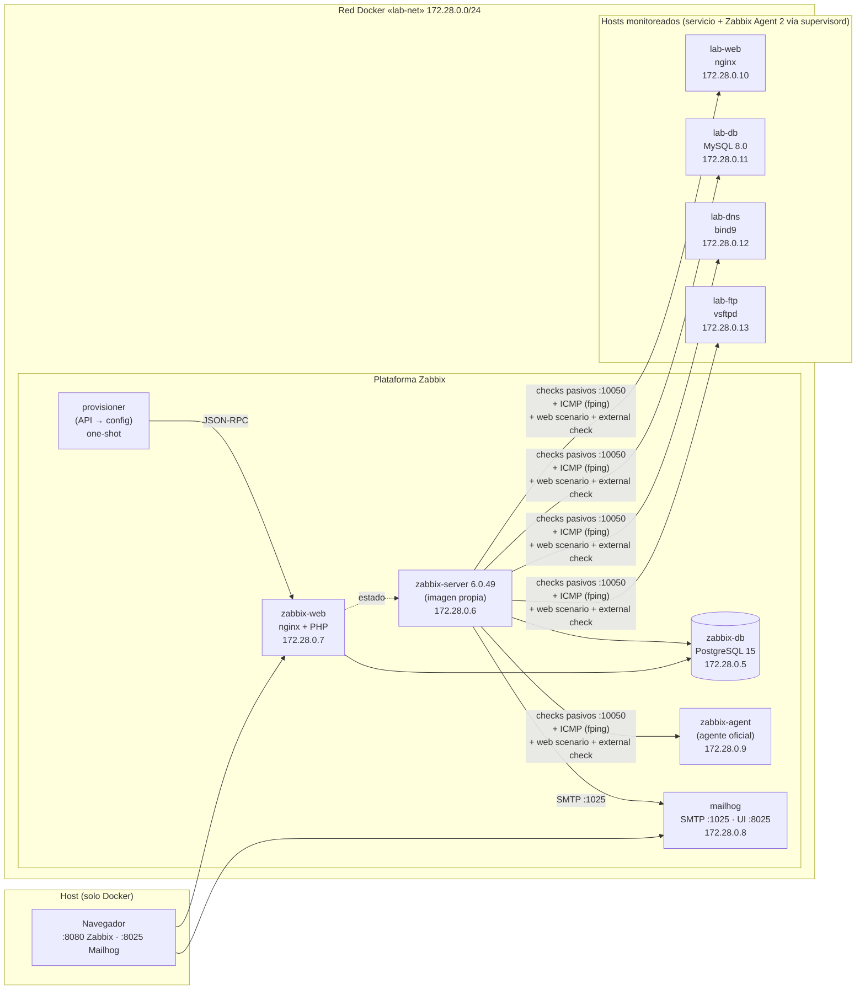

# Monitoreo de infraestructura con Zabbix 6.0 LTS — Docker Compose

**Servicios Telemáticos 2026-02 · Proyecto Final 7 (Lista 3: Monitoreo de infraestructura)**

Plataforma de monitoreo **100 % contenerizada**: Zabbix Server + PostgreSQL + frontend web supervisan una red de 4 hosts
(web, base de datos, DNS y FTP), generan alertas por correo (Mailhog) y muestran dashboards en tiempo real.
**No se instala nada en el host**: solo hace falta Docker con Compose v2.

Todo — hosts monitorizados, templates, triggers, acción de correo y dashboards — se configura **automáticamente por la API de Zabbix**
(contenedor `provisioner`), de modo que quien clone el repo solo ejecuta `docker compose up`.

```bash
git clone <URL-DEL-REPO> && cd <carpeta>
docker compose up -d --build        # primer arranque: ~5-8 min (construye imágenes + crea el esquema de la BD)
```

Cuando el contenedor `zabbix-provisioner` termine (`docker logs zabbix-provisioner` muestra *"Provisionamiento completo SIN avisos"*), abre:

| Qué | URL | Credenciales |
|---|---|---|
| **Frontend Zabbix** | <http://localhost:8080> | `Admin` / `zabbix` |
| **Mailhog** (correos de alerta) | <http://localhost:8025> | — |
| Dashboard del laboratorio | Monitoring → Dashboard → **Lab - Visión general** | — |

> ¿Ya tienes algo en el puerto 8080/8025? Copia `.env.example` a `.env` y cambia `WEB_PORT` / `MAILHOG_UI_PORT`.

---

## 1. Arquitectura



Detalle y decisiones de diseño en [`docs/arquitectura.md`](docs/arquitectura.md).
La comparación de alternativas (Zabbix vs Prometheus+Grafana vs Nagios vs Datadog) está en [`docs/matriz-decision.md`](docs/matriz-decision.md).

### Cumplimiento de requisitos del catálogo (Proyecto 7)

| Requisito | Dónde se cumple |
|---|---|
| ≥ 4 contenedores (web, DB, DNS, FTP) con Zabbix Agent | `lab-web`, `lab-db`, `lab-dns`, `lab-ftp` → `docker/*/Dockerfile` instalan **Zabbix Agent 2 6.0** |
| CPU, memoria y disco | Template *Linux by Zabbix agent* + métricas por contenedor (cgroup v2) + partición `/data` |
| Zabbix Server + BD + frontend | `zabbix-server`, `zabbix-db` (PostgreSQL), `zabbix-web` |
| Hosts, grupos, templates, triggers | `provisioning/lab_config.py` aplicado por `provisioning/provision.py` |
| Dashboards personalizados | *Lab - Visión general* (3 páginas) |
| Alertas por correo a Mailhog | Media type SMTP `mailhog:1025` + acción *Notificar problemas por correo* |
| Monitoreo de HTTP, MySQL, ping | Web scenario + `net.tcp.service`, *MySQL by Zabbix agent 2*, ICMP (fping) |
| **Imagen Zabbix personalizada con Dockerfile** | `docker/zabbix-server/Dockerfile` |
| **Configuración Zabbix montada como volúmenes** | `config/server/…`, `config/agent/…` (ver `docker-compose.yml`) |
| **README con inventario, servicios y URLs** | Este archivo |

---

## 2. Inventario de hosts monitoreados

| Host Zabbix | Contenedor / IP | Servicio | Templates | Qué se mide |
|---|---|---|---|---|
| `lab-web` | `lab-web` · 172.28.0.10 | nginx 1.27 (puerto 80) | Lab Web → Lab Base → *Linux by Zabbix agent* + *Nginx by Zabbix agent* | HTTP (puerto + web scenario con texto esperado), `stub_status`, procesos nginx |
| `lab-db` | `lab-db` · 172.28.0.11 | MySQL 8.0 (3306) | Lab DB → Lab Base + *MySQL by Zabbix agent 2* | `mysql.ping`, conexiones, queries, InnoDB, puerto 3306, proceso `mysqld`. Usuario `zbx_monitor` con privilegios mínimos |
| `lab-dns` | `lab-dns` · 172.28.0.12 | bind9 (zona `lab.local`) | Lab DNS → Lab Base | `net.dns` (resolución), `net.dns.record` (IP correcta), UDP/53, proceso `named` |
| `lab-ftp` | `lab-ftp` · 172.28.0.13 | vsftpd (21 + pasivo 30000-30009) | Lab FTP → Lab Base | `net.tcp.service[ftp]`, **login FTP real** (external check `ftp_login.sh`), proceso `vsftpd` |
| `Zabbix server` | `zabbix-agent` · 172.28.0.9 | Zabbix (auto-monitoreo) | *Linux by Zabbix agent*, *Zabbix server health* | Salud interna del propio Zabbix |

**Template base `Lab Base`** (heredado por los 4 hosts): ICMP (ping, pérdida, latencia, cada 10-30 s), CPU/RAM/procesos **por contenedor**
leídos del cgroup v2, disco `/data` (tmpfs de 64 MB) y los triggers de host caído, CPU, memoria y disco.

### Triggers y severidades

| Severidad | Trigger | Condición |
|---|---|---|
| **Disaster** | Host caído | 2 pings ICMP consecutivos fallan (~20 s) |
| **High** | Servicio caído (HTTP / MySQL / DNS / FTP / proceso ausente / web scenario) | 3 fallos consecutivos (~30 s) · dependen de «Host caído» |
| **High** | Disco `/data` crítico | uso > 90 % |
| Average | Agente sin datos · login FTP falla · DNS devuelve IP inesperada | nodata 60 s · 2 fallos · IP ≠ 172.28.0.10 |
| Warning | CPU alta | promedio 1 min > **85 %** del límite del contenedor |
| Warning | Memoria alta | promedio 1 min > **90 %** del límite |
| Warning | Disco `/data` casi lleno / latencia ICMP | 80–90 % · > 150 ms por 5 min |

Los umbrales son macros (`{$LAB.CPU.MAX}`, `{$LAB.MEM.MAX}`, `{$LAB.DISK.WARN}`, `{$LAB.DISK.CRIT}`) editables por host o template.
Además cada template oficial (Linux, Nginx, MySQL) aporta sus propios triggers.

**Alertas:** la acción *Notificar problemas por correo (Mailhog)* envía a `admin@lab.local` (vía `mailhog:1025`) todo problema de severidad ≥ Warning **y** su resolución.

---

## 3. Estructura del repositorio

```
.
├── docker-compose.yml          # 11 servicios, red lab-net, volúmenes, límites de recursos
├── .env.example                # variables (versiones fijadas, puertos, credenciales de laboratorio)
├── docker/
│   ├── zabbix-server/          # Dockerfile del server personalizado + externalscripts/ftp_login.sh
│   ├── web|db|dns|ftp/         # Dockerfile + supervisord.conf de cada host monitoreado
│   ├── common/                 # instalación de Agent 2 y entrypoint compartidos
│   └── provisioner/            # contenedor de automatización (Python estándar)
├── config/                     # configuración MONTADA COMO VOLUMEN
│   ├── agent/                  # zabbix_agent2.conf, UserParameters, lab-cgroup.sh
│   ├── server/                 # zabbix_server.conf.d/lab.conf
│   ├── web|db|dns|ftp/         # nginx, init de MySQL, zona bind, vsftpd.conf
├── provisioning/               # lab_config.py (QUÉ configurar) · provision.py (CÓMO) · measure.py
├── scripts/                    # pruebas: carga, caída de host/servicio, disco, reset de Mailhog
└── docs/                       # arquitectura, matriz de decisión, pruebas, problemas, informe, evidencias
```

---

## 4. Pruebas mínimas del catálogo

Todos los scripts requieren solo Docker (se ejecutan con Git Bash / WSL / Linux / macOS). Detalle de resultados en [`docs/pruebas.md`](docs/pruebas.md).

| # | Prueba | Comando | Qué observar |
|---|---|---|---|
| 1 | **Dashboard en tiempo real** (CPU/RAM/disco/servicios) | `scripts/test-stress.sh web 180` | Dashboard *Lab - Visión general* → pestaña **Recursos en tiempo real**: sube la curva de `lab-web` (y solo la suya) |
| 2 | **Caída de host** + **tiempo de detección** | `scripts/test-host-down.sh web` | `docker stop`, imprime segundos hasta el problema *Host caído* y hasta el correo; luego `docker start` y mide la recuperación |
| 3 | **Alerta en Mailhog** | (la generan las pruebas 1, 2 y 4) | <http://localhost:8025> |
| 4 | Caída de **servicio** (contenedor vivo) | `scripts/test-service-down.sh ftp` (o `web`, `db`, `dns`) | Se detiene solo el proceso; salta el trigger del servicio, no el de host |
| 5 | Disco | `scripts/test-disk-fill.sh web` / `… web limpiar` | Warning a 80 %, High a 90 % |
| 6 | **Métricas históricas** | Frontend → Monitoring → *Latest data* → gráfico de cualquier ítem | Rango 1 h/24 h/7 d; sirven para tendencias, capacidad y análisis post-incidente |

`scripts/reset-mailhog.sh` vacía la bandeja antes de grabar la demo.

---

## 5. Operación

```bash
docker compose ps                         # estado y healthchecks
docker logs zabbix-provisioner            # resultado de la automatización
docker compose run --rm provisioner       # re-aplicar la configuración (idempotente)
docker compose down                       # detener (conserva datos)
docker compose down -v                    # detener y BORRAR datos (BD, MySQL, FTP) → reinicio limpio
```

* Cambiar un umbral, agregar un host o un trigger: editar `provisioning/lab_config.py` y ejecutar `docker compose up -d --build provisioner`.
* Credenciales: todas son de laboratorio (`.env.example`). **No subas un `.env` real.** El usuario `Admin` conserva la clave por defecto `zabbix` de Zabbix.
* Subred fija `172.28.0.0/24`: si choca con otra red de tu máquina, cámbiala en `docker-compose.yml`, `config/agent/zabbix_agent2.conf` y `config/dns/zones/db.lab.local`.

---

## 6. Problemas encontrados y solución

Ver [`docs/problemas-encontrados.md`](docs/problemas-encontrados.md) (métricas de contenedor vs. VM, `fping`, vsftpd + `/dev/stdout`, falsos positivos al arrancar, etc.).

## 7. Versiones

Zabbix Server / Web / Agent 2 **6.0.49** (LTS) · PostgreSQL 15 · MySQL 8.0 · nginx 1.27 · bind9 9.18 (Debian 12) · vsftpd 3.0.3 · Mailhog v1.0.1.
