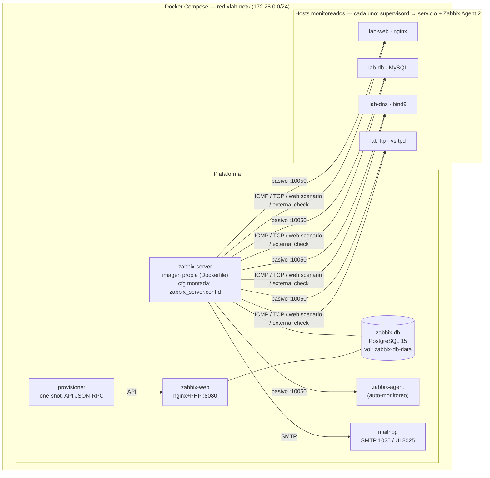

# Arquitectura y decisiones de diseño

## 1. Vista general

Puertos publicados al host: **8080** (frontend Zabbix) y **8025** (UI de Mailhog, necesaria para ver los correos).
Todo lo demás (PostgreSQL 5432, trapper 10051, agentes 10050, SMTP 1025, servicios) es **solo interno** a `lab-net`.

## 2. Flujo de datos

| Origen → destino | Mecanismo | Para qué |
|---|---|---|
| Server → Agent 2 (:10050) | Check **pasivo** de Zabbix | CPU/RAM (cgroup), disco, procesos, `net.dns`, MySQL, nginx |
| Server → host | **ICMP** (`fping`) | Disponibilidad (host caído) y latencia |
| Server → servicio | Simple check `net.tcp.service`, **web scenario** HTTP, **external check** FTP | Visión *desde fuera* del servicio (lo que vería un cliente) |
| Server → Mailhog (:1025) | SMTP sin autenticación | Notificaciones de problema y recuperación |
| Provisioner → Web (API) | JSON-RPC | Crear grupos, templates, hosts, acción, dashboards |

Se combinan dos puntos de vista a propósito: el **agente** ve el servicio desde dentro del host y el **servidor** desde la red.
Si el host cae, solo el segundo sigue informando (por eso el trigger de *Host caído* se basa en ICMP del servidor).

## 3. Decisiones de diseño (con justificación)

### 3.1 Agente: imagen propia con supervisord vs. contenedor «sidecar»
El enunciado propone dos opciones. **Elegimos una imagen propia por host (servicio + Agent 2 gestionados por supervisord).**

| | Imagen propia + supervisord (elegida) | Sidecar `network_mode: service:X` |
|---|---|---|
| «Host» = 1 contenedor | ✔ `docker stop lab-web` apaga servicio **y** agente: la prueba del catálogo («detener un contenedor») es literal | ✘ al parar el contenedor principal, el sidecar queda huérfano con red muerta |
| Reinicio | ✔ `docker restart` basta | ✘ hay que reiniciar también el sidecar (o `depends_on: restart: true`) |
| Visibilidad de procesos/cgroup/FS | ✔ el agente comparte PID, cgroup y sistema de archivos con el servicio (`proc.num`, cgroup, `/data`) | ✘ requiere `pid: service:X` y volúmenes compartidos |
| Principio «1 proceso por contenedor» | ✘ se rompe (supervisord) | ✔ |
| Imágenes oficiales sin modificar | ✘ (se construyen sobre la oficial: `nginx`, `mysql:8.0-debian`, `debian`) | ✔ |

Como el objetivo es *simular hosts* que un administrador monitoriza «instalando un agente», la primera opción representa mejor el escenario real.

### 3.2 Métricas de CPU/RAM por contenedor (cgroup v2)
Dentro de un contenedor, `/proc/stat` y `/proc/meminfo` muestran el kernel compartido (toda la VM de Docker): estresar `lab-web` haría subir la CPU
de **los cuatro** hosts en el template estándar. Para que el dashboard y las alertas distingan contenedores:

* `config/agent/lab-cgroup.sh` lee `cpu.stat`, `memory.current/max` y `pids.current` del **cgroup v2 del contenedor** (UserParameter `lab.cg[...]`).
* Cada host tiene límites de recursos (`cpus: 1.0`, `mem_limit`) y los porcentajes se calculan **respecto a ese límite**: 100 % = el contenedor agotó su cuota.
* Se conserva el template oficial *Linux by Zabbix agent* para todo lo demás (carga, red, procesos, sistema de archivos, inventario).

### 3.3 Disco `/data`
El disco raíz de un contenedor refleja el de la VM (cientos de GB): imposible llegar al 90 % en una demo. Cada host monta un **tmpfs de 64 MB** en `/data`;
llenarlo con `dd` (script `test-disk-fill.sh`) cruza el 80 % y el 90 % de forma controlada y segura.

### 3.4 Base de datos de Zabbix: PostgreSQL
Soportado oficialmente por 6.0, imagen `alpine` pequeña, healthcheck nativo (`pg_isready`) y volumen persistente. El host monitoreado «DB» usa **MySQL 8.0 real**
(el catálogo pide el template *MySQL by Zabbix agent 2*).

### 3.5 Imagen personalizada del Zabbix Server (requisito del catálogo)
`docker/zabbix-server/Dockerfile` parte de `zabbix/zabbix-server-pgsql:alpine-6.0.49` y agrega: herramientas de diagnóstico (`dig`, `nc`, `curl`),
el script de *external check* `ftp_login.sh` (login FTP real con `curl`, ejecutable) y el `Include` que permite **montar configuración como volumen**
(`config/server/zabbix_server.conf.d/lab.conf`: pingers, tiempos de «host inalcanzable», etc.).

### 3.6 Automatización por API (`provisioner`)
Un contenedor de Python (solo librería estándar) lee `provisioning/lab_config.py` —descripción declarativa de grupos, templates, items, triggers, hosts, macros y dashboards—
y lo aplica de forma **idempotente** por JSON-RPC. Así:

* `docker compose up` deja el sistema listo sin clics en el frontend;
* la configuración vive en Git (revisable, versionada);
* repetir la ejecución actualiza en lugar de duplicar.

### 3.7 Detección rápida (justificación de intervalos)
Para que la demo y la medición del *tiempo de detección* sean prácticas: ICMP cada 10 s, servicios cada 10 s, `UnreachablePeriod=30 s`.
Costo: algo más de carga de polling, irrelevante con 5 hosts. En producción se usarían intervalos de 30-60 s.

### 3.8 Seguridad (alcance de laboratorio)
* Agentes en modo pasivo y `Server=172.28.0.0/24`: solo la red del laboratorio puede consultarlos.
* `zbx_monitor` en MySQL con privilegios mínimos (`REPLICATION CLIENT, PROCESS, SHOW DATABASES, SHOW VIEW`); la contraseña es macro **secreta** en Zabbix.
* Solo 8080 y 8025 expuestos; credenciales en `.env` (ignorado por Git), con `.env.example` documentado.
* Limitaciones asumidas: sin TLS entre componentes, `Admin/zabbix` por defecto, `FTP_PASS` como macro de texto (necesaria en la clave del external check).

## 4. Volúmenes y persistencia

| Volumen | Contenido | `down` | `down -v` |
|---|---|---|---|
| `zabbix-db-data` | BD de Zabbix (histórico, configuración) | se conserva | se borra |
| `lab-db-data` | datos de MySQL | se conserva | se borra |
| `lab-ftp-data` | home del usuario FTP | se conserva | se borra |
| (bind mounts `./config/...`) | configuración, solo lectura | — | — |
